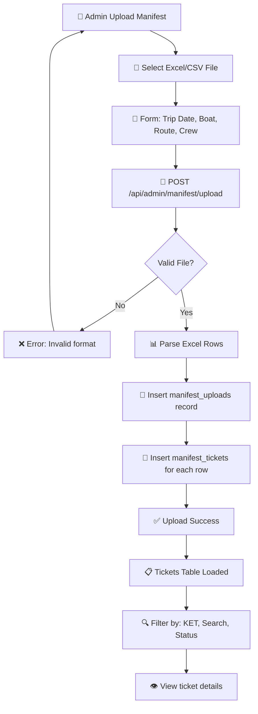
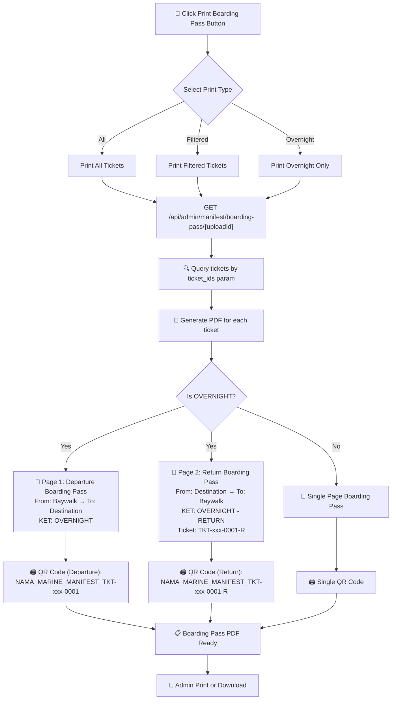
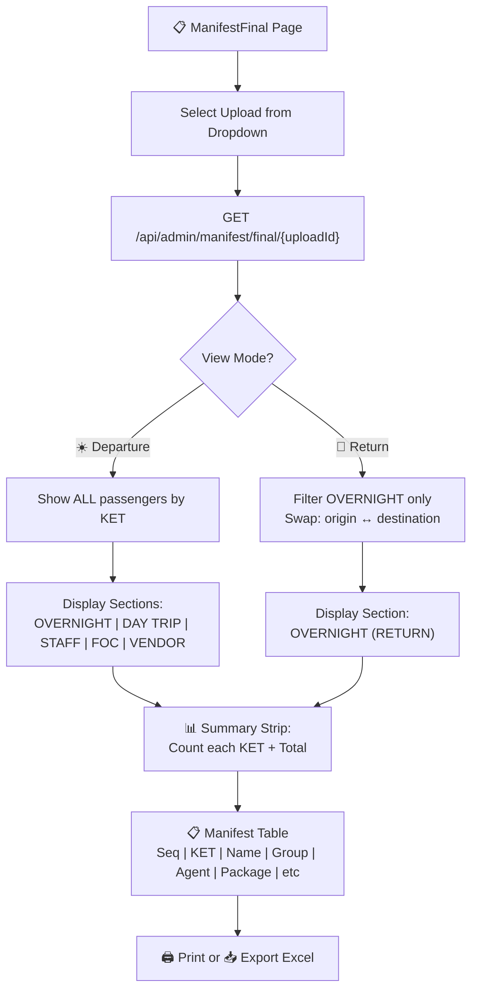
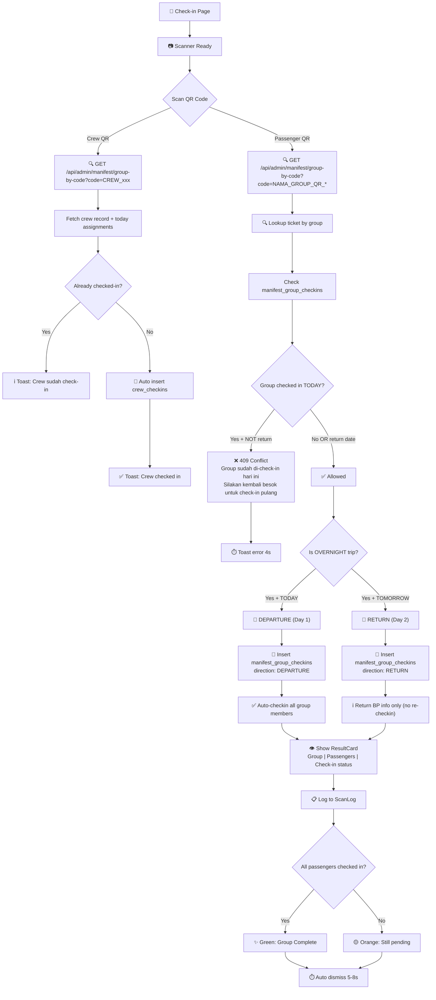
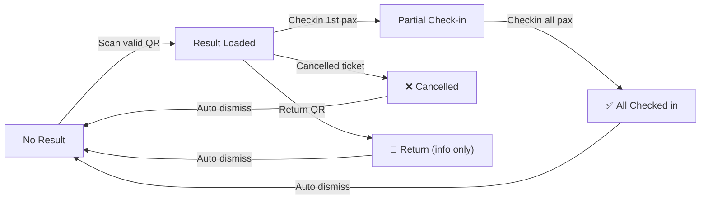
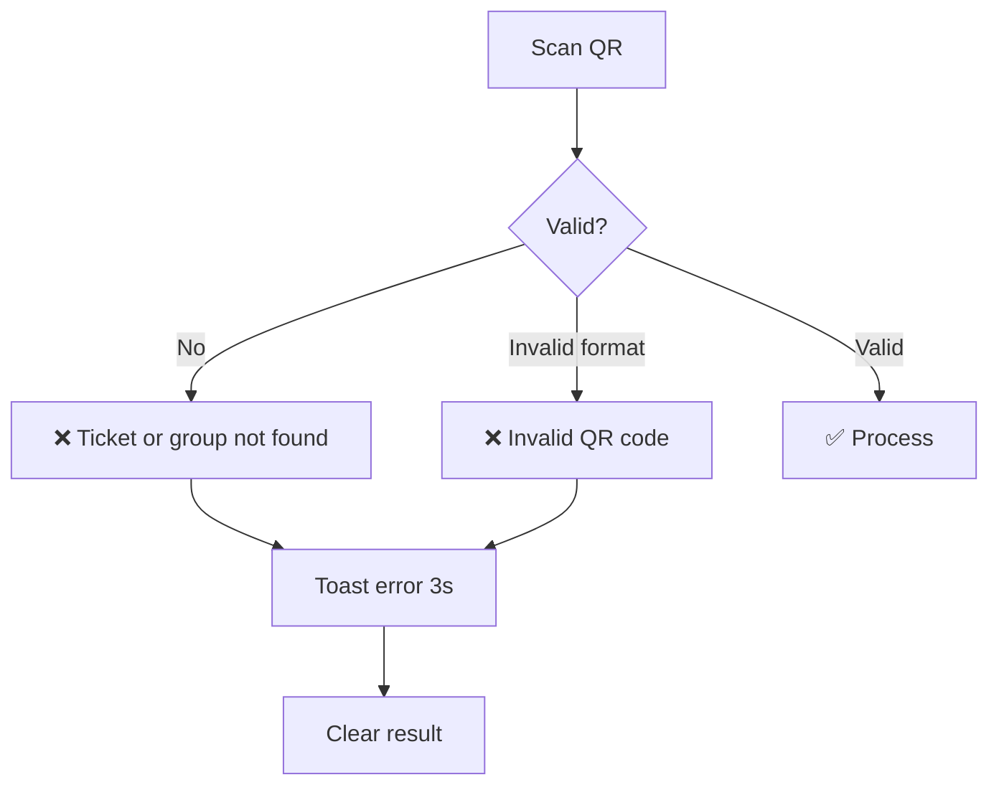

# Flow Chart: Upload Manifest → Check-in

## 1. Upload Manifest Flow



---

## 2. Boarding Pass Generation Flow



---

## 3. Manifest Final & Return View Flow



---

## 4. Boarding Pass Scan & Check-in Flow (NEW: Same-Day Blocking)



### Key Changes for Same-Day Check-in Blocking:

- **New table:** `manifest_group_checkins` tracks group scans by date + direction
- **Single QR per group:** No `-R` suffix (was: separate QR for return)
- **Return detection:** Trip date + 1 day for overnight trips
- **Same-day re-scan:** Returns 409 Conflict unless is_return flag set
- **Auto tracking:** Group check-in recorded in DB on successful scan
- **Email auto-blast:** Parse EMAIL column from manifest, send QR via email

---

## 5. Detailed Check-in State Flow



---

## 6. Database Schema (Simplified)

```
manifest_uploads
├── id (PK)
├── boat_id
├── trip_date
├── direction (DEPARTURE/RETURN)
├── origin
├── destination
├── captain_name
├── abk_names (JSON crew)
├── gro_name
├── status (DRAFT/ACTIVE/ARCHIVED)
├── overnight_count
├── daytrip_count
├── staff_count, foc_count, vendor_count
├── group_qr_codes (JSON, NEW)
├── qr_generation_status (ENUM: pending|generated, NEW)
├── qr_emails_sent_at (DATETIME, NEW)
└── created_at

manifest_tickets
├── id (PK)
├── upload_id (FK → manifest_uploads)
├── seq_no
├── ket (OVERNIGHT/DAY TRIP/STAFF/FOC/VENDOR)
├── passenger_name
├── group_name
├── agent
├── package
├── pax_count
├── seat_number
├── ticket_code (e.g., TKT-5-0001)
├── checked_in (0/1)
├── cancelled (0/1)
├── id_passport
├── domicile
├── email (NEW: parsed from Excel manifest)
├── notes
└── created_at

manifest_group_checkins (NEW TABLE)
├── id (PK)
├── upload_id (FK)
├── group_name
├── checked_in_at (DATETIME)
├── direction (ENUM: DEPARTURE|RETURN, NEW)
├── notes
└── indexes: (upload_id, group_name), checked_in_at

crew_checkins
├── id (PK)
├── crew_id (FK → crew)
├── assignment_id
├── schedule_id
├── checked_in_at
└── note

boarding_pass_pdf (generated on-demand)
└── No DB storage, generated via TCPDF
```

---

## 7. API Endpoints Summary

| Method | Endpoint                                                  | Purpose                                                   |
| ------ | --------------------------------------------------------- | --------------------------------------------------------- |
| POST   | `/api/admin/manifest/upload`                              | Upload manifest Excel                                     |
| GET    | `/api/admin/manifest/uploads`                             | List all uploads                                          |
| GET    | `/api/admin/manifest/final/{id}?view=departure\|return`   | Get manifest final (with optional return view)            |
| POST   | `/api/admin/manifest/boarding-pass/{id}?ticket_ids=1,2,3` | Generate boarding pass PDF                                |
| GET    | `/api/admin/manifest/group-by-code/{code}`                | **NEW:** Scan QR → fetch group (blocks same-day re-scans) |
| POST   | `/api/admin/manifest/boarding-pass-self-service`          | **NEW:** Generate BP PDF from scanned QR                  |
| GET    | `/api/admin/manifest/group-qr-codes/{uploadId}`           | **NEW:** Fetch all generated group QR codes               |
| POST   | `/api/admin/manifest/send-group-qr-emails`                | **NEW:** Blast QR codes to group emails                   |
| POST   | `/api/admin/manifest/checkin-bulk`                        | Check-in multiple tickets                                 |
| GET    | `/api/admin/manifest/export-excel/{id}`                   | Export manifest to Excel                                  |

---

## 8. Key Features

### ✅ Group QR Code Self-Service

- **Single QR per group** (no `-R` suffix)
- Lead group member scans QR to generate boarding pass
- Email auto-blast: EMAIL column from manifest parsed and used
- Same-day re-scan blocking: cannot scan again same day
- Return next-day access: can scan again tomorrow (overnight trips)

### ✅ Same-Day Check-in Blocking

- Track group scans in `manifest_group_checkins` table
- Block re-scans same day with 409 Conflict error
- Allow return scans next day (trip_date + 1)
- Direction tracking: DEPARTURE vs RETURN

### ✅ Departure Boarding Pass

- 1 halaman per ticket
- QR: `NAMA_GROUP_QR_*` (group-based, not ticket-based)
- Route: From → To

### ✅ Overnight Boarding Pass (Single QR)

- **Departure page:** Baywalk → Destination, KET: OVERNIGHT
- **Return page:** Destination → Baywalk, KET: OVERNIGHT - RETURN
- **Same QR for both** (no -R suffix)
- Return detection: trip_date + 1 = today
- Check-in status: 409 Conflict if scanned again same day

### ✅ Check-in Behavior

- **Departure ticket scan:** Auto-checkin unless already done
- **Return ticket scan (-R):** Info only, NO re-checkin
- **Crew QR:** Auto check-in if not already done
- **Auto dismiss:** 6-8s after successful scan

### ✅ Return Manifest Final

- Filter only OVERNIGHT passengers
- Swap origin ↔ destination
- Show as "MANIFEST PENUMPANG KEPULANGAN (OVERNIGHT)"
- Title "OVERNIGHT (RETURN)" in section header

---

## 9. Error Handling



---

## 10. Timeline Example

```
08:00 - Upload manifest (50 overnight, 30 day trip)
        ↓
08:05 - Print Overnight BP (50 pax × 2 pages = 100 pages)
        ↓
08:10 - Print Day Trip BP (30 pax × 1 page = 30 pages)
        ↓
08:15 - Passengers arrive at port
        ↓
08:20 - Check-in starts: scan departure QR
        ├─ Overnight pax: auto-checkin ✓
        ├─ Day trip pax: auto-checkin ✓
        └─ Toast: "Group XYZ all checked in"
        ↓
09:00 - Boat departs with all passengers checked in
        ↓
12:00 - Overnight boat arrives at destination
        ↓
12:05 - Return check-in phase: scan return QR (-R)
        ├─ Return BP scanned: 🌙 Return Boarding Pass (info only)
        ├─ No re-checkin (departure already done)
        └─ Toast: "Return boarding pass valid"
        ↓
13:00 - Boat returns to origin
```
