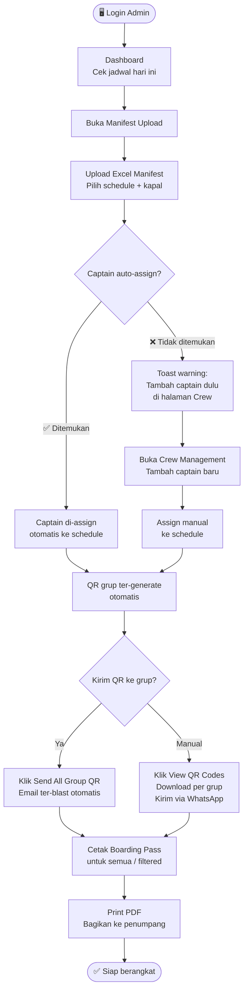
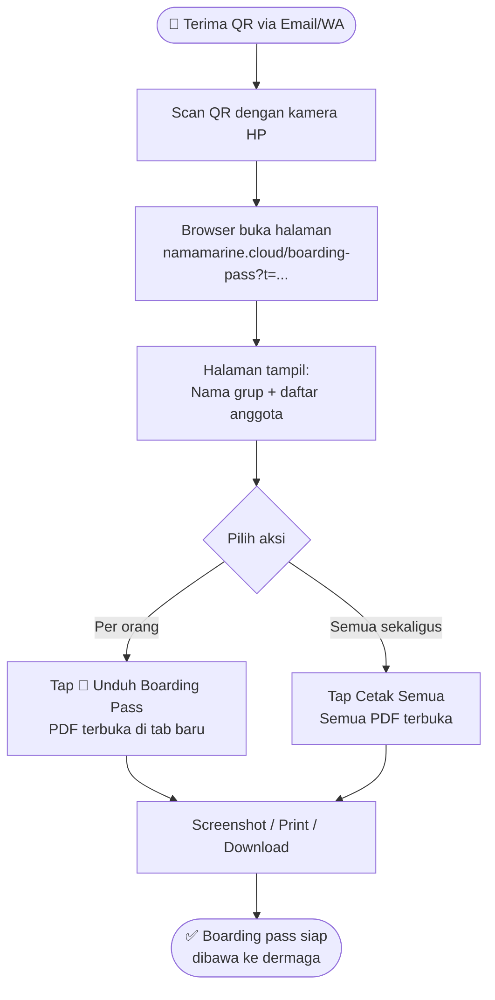
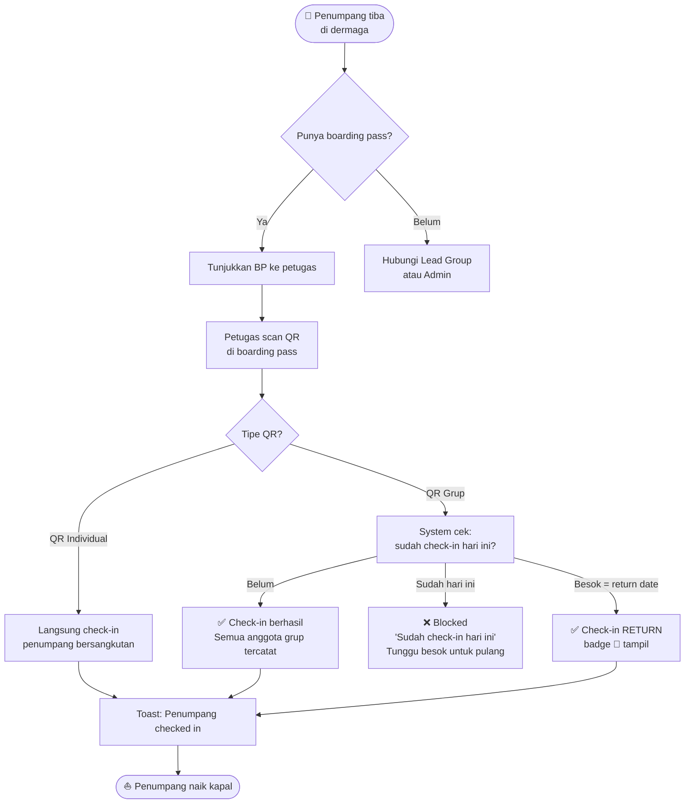
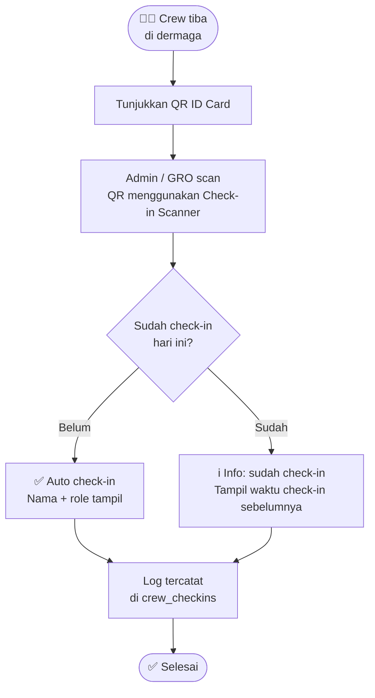
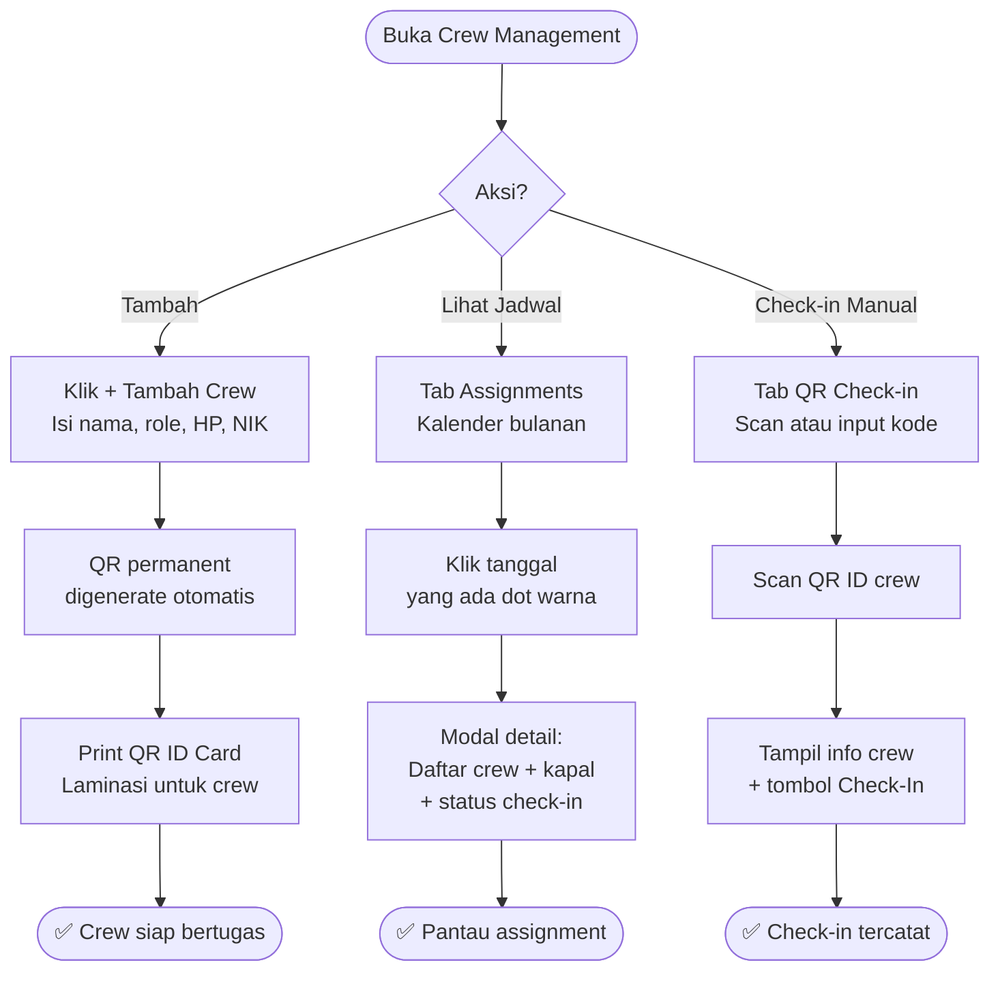
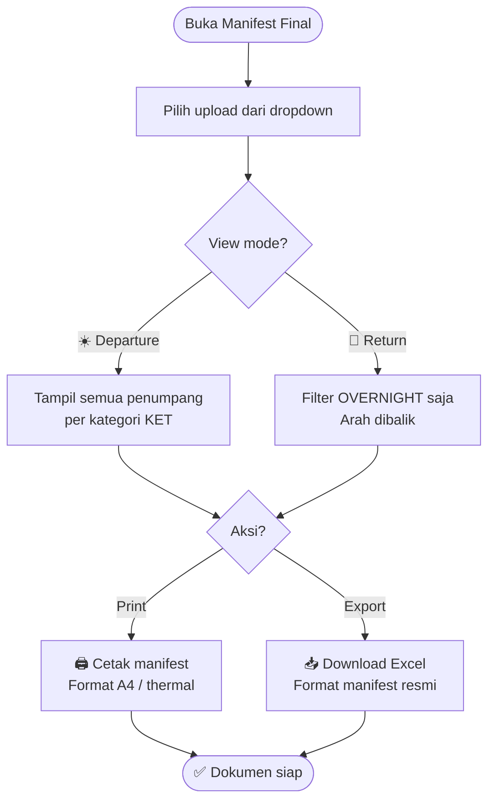

# Panduan Operasional NAMA Marine System
## Training Guide — Admin, Captain, GRO, ABK, Staff

---

## ROLE & AKSES

| Role | Akses System | Tugas Utama |
|------|-------------|-------------|
| **Admin** | Full access — dashboard, manifest, crew, booking | Upload manifest, manage semua data |
| **Captain** | Scan QR check-in (via PDA/HP) | Validasi penumpang naik kapal |
| **GRO** | Scan QR check-in (via HP) | Assist check-in di dermaga |
| **ABK** | Scan QR check-in (opsional) | Bantu boarding |
| **Staff** | Lihat manifest (opsional) | Operasional darat |
| **Lead Group** | Scan QR grup → download boarding pass | Self-service cetak boarding pass |

---

## 1. FLOW ADMIN — Hari Trip



---

## 2. FLOW LEAD GROUP — Ambil Boarding Pass Sendiri



---

## 3. FLOW CHECK-IN DI DERMAGA



---

## 4. FLOW CREW CHECK-IN



---

## 5. FLOW ADMIN — Kelola Data Crew



---

## 6. FLOW MANIFEST FINAL & EXPORT



---

## 7. ALUR HARIAN LENGKAP (TIMELINE)

```
06:00  Admin upload manifest Excel
       → Captain auto-assign ke schedule
       → QR grup ter-generate
       ↓
06:30  Admin kirim QR ke lead group (email / WA)
       ↓
07:00  Lead group scan QR → download boarding pass semua anggota
       ↓
07:30  Penumpang tiba di dermaga
       → GRO / Captain scan boarding pass
       → Check-in departure tercatat
       ↓
08:00  Kapal berangkat
       ↓
---  Overnight trip ---
       ↓
Next day 08:00  Penumpang scan QR yang sama
                → Sistem deteksi: beda tanggal = return trip
                → Check-in return tercatat (badge 🌙 RETURN)
       ↓
09:00  Kapal kembali ke asal
```

---

## 8. PANDUAN SCANNER (Captain / GRO)

### Pakai HP / Tablet (Camera Mode)
1. Buka `namamarine.cloud/admin/checkin`
2. Login dengan akun admin
3. Tap **Start** di QR Scanner
4. Arahkan kamera ke QR boarding pass penumpang
5. Sistem auto check-in — dengar bunyi *beep* tanda berhasil

### Pakai PDA Scanner (Hardware Mode)
1. Buka halaman check-in
2. Klik tombol **PDA Scanner** (kanan atas)
3. Input field sudah fokus otomatis
4. Arahkan PDA ke QR — scanner langsung input kode
5. Sistem auto check-in tanpa perlu klik apapun

### Troubleshooting
| Masalah | Solusi |
|---------|--------|
| QR tidak terbaca | Pastikan pencahayaan cukup, coba input manual |
| "Sudah check-in hari ini" | Normal — penumpang sudah scan sebelumnya |
| "Ticket not found" | QR rusak/salah — cek manual di manifest |
| Kamera tidak aktif | Izinkan akses kamera di browser |

---

## 9. PANDUAN LEAD GROUP

### Cara Ambil Boarding Pass
1. Cek email / WhatsApp dari NAMA Marine
2. Ada QR code dengan nama grup kamu
3. Scan QR menggunakan kamera HP
4. Browser otomatis buka halaman boarding pass
5. Tap **🎫 Unduh Boarding Pass** per anggota
6. Atau tap **Cetak Semua** untuk semua anggota sekaligus
7. Screenshot / print / simpan PDF

### Catatan Penting
- Satu QR untuk **semua anggota grup** — cukup lead group yang pegang
- QR berlaku untuk **departure dan return** (overnight)
- Setelah scan departure → QR tidak bisa scan lagi di hari yang sama
- Besok (return day) → scan QR yang sama untuk boarding pulang

---

## 10. KONTAK & ESKALASI

| Masalah | Hubungi |
|---------|---------|
| Penumpang tidak ada di manifest | Admin NAMA Marine |
| QR tidak bisa dibuka | Admin — minta resend QR |
| Kursi salah / ganda | Admin — switch seat di manifest |
| Kapal overbooked | Captain → Admin segera |

---

*Dokumen ini dibuat otomatis oleh sistem NAMA Marine.*
*Last updated: September 2026*
